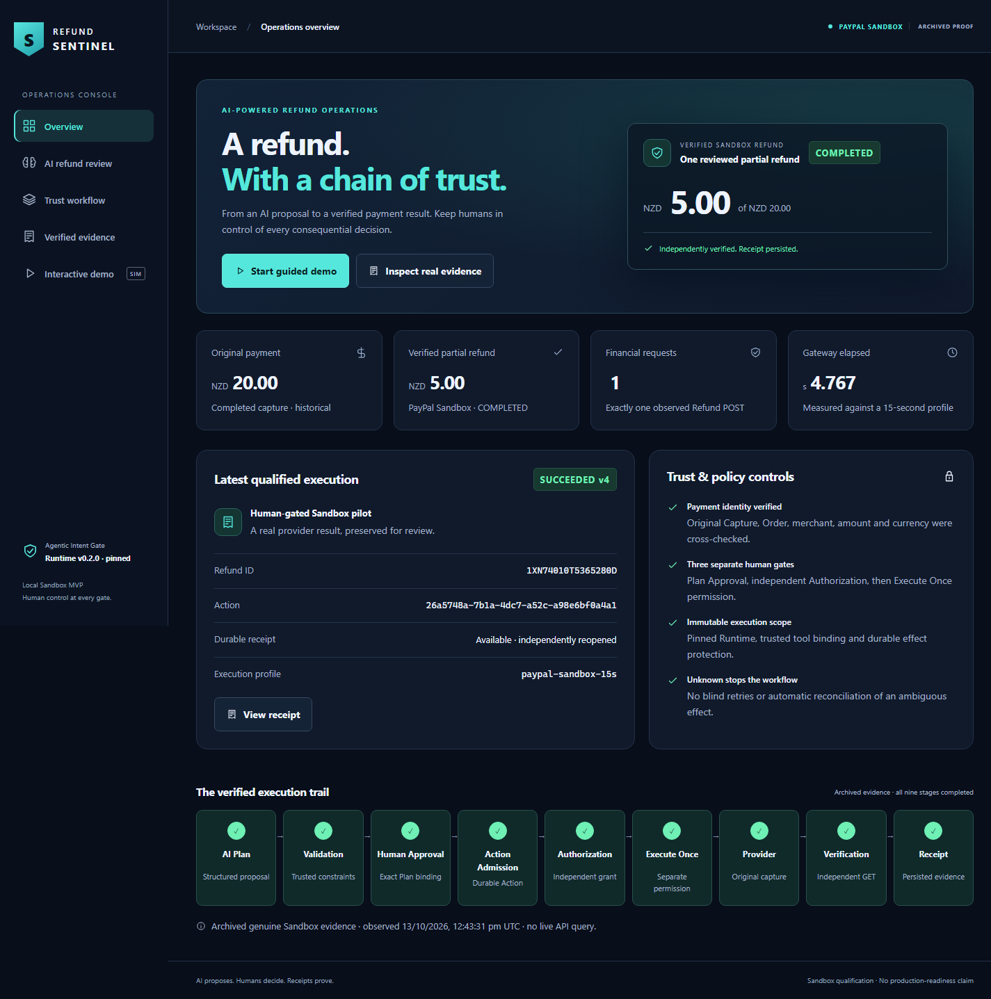

# Refund Sentinel

**AI proposes. Humans decide. Receipts prove.**

Refund Sentinel is a local merchant console for AI-assisted partial refunds. It
turns a damaged-item request into a bounded Plan, lets a human review each decision,
and presents the evidence behind the result. An AI recommendation should not, by
itself, move money.

For merchant support teams reviewing AI-suggested refunds, the **AI Decision Lab**
shows the authority boundary in five synthetic cases: a valid partial refund,
an unspecified amount, an excessive request, prompt injection and a lost
acknowledgment. Inspect the actual proposal, deterministic verdict, separate
human gates and simulated outcome together. **AI can recommend a refund. Only
verified authority can move money.**

The working five-screen app combines genuine local Ollama inference, three separate
human gates and durable execution through an external pinned Runtime. Interactive
payments are isolated simulations. A read-only archive records one genuine PayPal
Sandbox refund: **NZD 5.00 from NZD 20.00**, independently verified **COMPLETED**,
with one observed Refund POST and a durable Receipt.

## Run the demo

Use **Python 3.13**, Git and [uv](https://docs.astral.sh/uv/). Initial installation
needs package/Git access. The exact Runtime Git release is pinned in `pyproject.toml`
and `uv.lock`; it is not a PyPI release.

```powershell
uv sync --frozen --all-extras
.venv\Scripts\python -m refund_sentinel.presentation --port 8880
```

Open **http://127.0.0.1:8880**. No PayPal credentials, login, capability upload or
`.env` setup is needed. The presentation ignores existing `.env` and never mounts
financial execution routes. On macOS/Linux use `.venv/bin/python`; Windows is the
qualified demo platform.

**Deterministic Demo** works offline after installation. For genuine AI, install
Ollama separately, provide `phi4-mini:latest` at its default local endpoint, and
select **Local AI Demo — Live Ollama**. This repository does not install Ollama or
download a model. Unavailable/invalid model output is shown honestly; deterministic
fallback requires an explicit choice.

## What is real?

| Component | Boundary |
| --- | --- |
| Local AI proposal | Genuine `phi4-mini:latest` on a synthetic incident; strict schema and policy validation |
| Deterministic proposal | Labeled offline fixture; no model call |
| Interactive payment | FakePayPal only: trusted USD 120.00 payment; allowed refund USD 25.00; USD 150.00 requests denied; no PayPal request |
| Execution control | Genuine installed Agentic Intent Gate v0.2.0: exact Approval, independent Authorization, durable claim and result |
| Historical evidence | Genuine past Sandbox POST 201, independent GET 200 / COMPLETED and durable Receipt; viewing it performs no current verification |

PayPal is the backend integration, not a decorative label. The separate Sandbox
adapter reads Payments v2 captures and Orders v2 facts, validates merchant, money
and association, submits an explicitly authorized partial refund with a durable
request ID, and independently reads the Refund before claiming completion. See
the [original sanitized proof](evidence/phase2-freeze/verified-refund.json) and
[frozen backend contract](docs/PHASE2-BACKEND-FREEZE.md).

## Walk through the product

1. **Overview:** the product and historical qualified result.
2. **AI refund review:** archived genuine recommendation and exact Plan.
3. **Trust workflow:** separate Approval, Authorization and execution permission.
4. **Verified evidence:** original Sandbox HTTP results and historical Receipt.
5. **Interactive demo:** load a case, generate a Plan, then separately confirm
   **Approve Plan → Authorize Action → Execute Simulation**. Open its Receipt and reload.

On screen five, choose **cases A–E**. The default is A. Local AI preserves its actual
bounded output, including rejected recommendations; missing amounts and excessive
requests produce evidence without an executable Run or Action. Prompt injection may
be rejected or may yield a valid proposal; it never grants authority. The offline
injection fixture deliberately proposes the excessive amount to demonstrate policy
denial. Model errors require an explicit fallback into a new case. Download a
sanitized synthetic evidence projection; it contains no credentials or raw provider
payloads and makes no signature/authenticity claim. Original demonstration profiles
and saved sessions remain supported.

Approval and Authorization each leave dispatch count at zero. Only the third
confirmation executes the simulation. Unknown and Failed remain terminal, with
no retry or automatic reconciliation. Reset retains earlier synthetic cases and
creates a fresh scope.



## Documentation

| Guide | Purpose |
| --- | --- |
| [UI setup and QA](docs/PHASE3-UI-DEMO.md) | Ollama, state, browser regressions, packaging and platform limits |
| [Phase 4 acceptance](docs/PHASE4-AWARD-UPGRADE-REPORT.md) | Decision Lab scenarios, actual tests, browser/model evidence and judging risks |
| [Demo script](docs/DEMO-SCRIPT.md) | English 2–3 minute walkthrough and 60-second pitch |
| [Architecture](docs/architecture.md) | Runtime reuse, trusted policy, identities, budgets and outcomes |
| [Sandbox developer guide](docs/sandbox-setup.md) | Separate 8879 workflow, configuration and financial authorization boundaries |
| [Backend freeze](docs/PHASE2-BACKEND-FREEZE.md) | Immutable financial implementation and original Sandbox qualification |
| [Competition requirements](docs/competition.md) | Official sources, contribution and remaining submission work |
| [Curated evidence](evidence/submission/README.md) | Screenshots, qualification summary and historical archive |
| [Final cleanup report](docs/SUBMISSION-CLEANUP-REPORT.md) | Five batches, actual release qualification, preserved state and remaining work |

Earlier engineering reports remain in the
[pre-cleanup checkpoint](https://github.com/miku-wwl/refund-sentinel-agent/tree/86a179fc6ca02568a849c51e765d6dca123dced7).

## Runtime and license

The application reuses **Agentic Intent Gate 0.2.0**, pinned to
[`7261fdd2f47d2b15fabe8faac527eeee37338eb1`](https://github.com/miku-wwl/agentic-intent-gate/commit/7261fdd2f47d2b15fabe8faac527eeee37338eb1).
It does not copy or modify Runtime validation, Runs, exact approval binding,
Authorization, claiming, CAS, effect identity or Unknown handling. Startup verifies
installed Git provenance. The application and pinned Runtime are MIT licensed;
see [LICENSE](LICENSE) and the pinned Runtime's license. Credentials never belong
in installation URLs or public artifacts.

## Limits and remaining work

This is a single-operator, loopback Sandbox MVP. One historical sample establishes
neither today's refund balance, a latency distribution, production readiness nor
universal exactly-once delivery. The default adapter budget is five seconds; the
separately reviewed historical Sandbox profile has fifteen seconds and a distinct
binding/state identity. Remote success can still coincide with a local Unknown.
Existing Actions are never elevated to a longer budget or replayed.

Video recording, YouTube upload, hosted deployment and final Hackathon entry are
separate work and are not claimed completed. No new financial operation is needed
to demonstrate the application.
