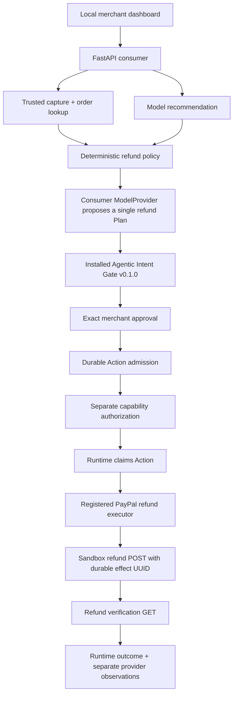

# Architecture and safety boundary

## Ownership

- Runtime owns validation of the single-step Plan, persistent Runs, exact approval binding, compilation, capability verification, independent authorization, durable claiming, CAS, duplicate command handling, effect identity, recovery and Action result recording. Consumer code imports **only** `agentic_intent_gate.runtime`; it neither imports internal modules nor patches the Runtime.
- Consumer owns recommendation parsing, merchant policy, provider credentials, capture/order lookup, concrete executor, product observations and frontend. `IncidentPlanProvider.generate_plan` constructs a Plan from a schema-checked recommendation with trusted tool/target constants. Model text cannot register tools or select credentials, adapters, targets or scopes.
- `application.sqlite3` stores incident context and append-only provider observations. It is not an execution-control store. `gate.sqlite3` belongs to the Runtime. `fake-paypal.sqlite3` is an explicitly simulated provider store, including attempted calls and effects.

## Trusted composition

Startup registers `paypal_partial_refund/1` with `ToolBinding`, `ToolCapability` and `ExecutableRegistry`. Binding identity includes `paypal-sandbox-adapter`, `refund-binding-v1`, `paypal-sandbox-refunds` and a persisted UUID scope. A semantic rule validates arguments against the incident and merchant policy. `CapabilityVerifier` and `BoundCapabilityAuthorization` enforce the trusted operator/scope; the model sees neither capability nor credentials.

Public commands used: `Intent`, `run_service.create/get/decide`, `ApprovalDecisionRequest`, `ApprovalChoice`, `AdmissionCommand`, `ActionCommand`, `gateway.admit/authorize/execute/get/list_for_run`, `ToolOutcome`, `Outcome`, `open_runtime`, `provision_capability`. Reads use the supported repository/gateway snapshots. No bundled Demo UI or service-demo prompt is reused.

## Narrow policy

An immutable persisted configuration fixes provider mode, merchant, capture allowlist, interpretation mode and maximum amount. Policy permits USD/NZD only, two-decimal strings parsed with Decimal, a positive partial amount strictly below the captured amount and at most the configured maximum (default 100.00). Capture and associated order must agree; merchant identity must match; no previous refunds are allowed. High interpretation uncertainty or REVIEW/REJECT produces no executable Plan.

Each capture has one product incident per state directory, including rejected/interrupted incidents. This conservative business boundary prevents creating a fresh incident to bypass an Unknown Action. It is not a remote exactly-once guarantee; do not use fresh state directories or another client to retry unresolved refunds. Capture facts are rechecked immediately before POST. External concurrent activity remains outside local guarantees; PayPal remains authoritative.

## Outcome semantics

| Evidence | Runtime result | Product display |
|---|---|---|
| Refund GET matches ID, capture link, exact amount/currency and COMPLETED | Succeeded, UUID observation receipt | Provider confirmed completion at lookup time |
| Policy rejected before POST or documented definitive HTTP rejection | Failed | No-effect diagnostic; external call count shown in tests |
| Timeout, transport error, 5xx, malformed response, mismatch or failed lookup | Unknown | Available observations; no retry |
| GET returns PENDING, FAILED or CANCELLED | Unknown | Exact provider state shown separately; completion not confirmed |

The baseline has a **five-second executor deadline**, no Pending Action terminal state, and a limited no-effect result vocabulary. A provider FAILED/CANCELLED observation is conservatively retained as Unknown because it does not establish the baseline's supported no-effect proof. Receipts reference a local observation UUID, not a PayPal refund ID. A refund ID is stored separately. Manual status checks issue GET only, append observations, and never rewrite Unknown or dispatch POST.

The executor performs fresh capture/order reads, POST and refund GET inside the unchanged deadline. Slow Sandbox responses may therefore yield Unknown even if PayPal applied the refund. There are no background helpers, retries or reconciliation endpoints.

## Local application restrictions

Explicit `init` provisions private operator credentials and state. Startup performs no payment fixture creation. Serve holds the Runtime single-owner fence for the complete lifespan; one process, one worker, loopback binding. `--predecessor-stopped` is an operator assertion and must only be used after the prior owner stops. State survives restart. Cross-store writes are not one atomic transaction: a crash during analysis can leave an interrupted incident or orphan Run; the incident remains reserved and must be inspected rather than retried.

The capability is loaded from a selected local file into browser memory, not localStorage or URLs. Protected HTTP routes require the Bearer capability. Local host and origin checks, no CORS, no-store responses, CSP and no external assets reduce exposure. This is not multi-user identity, production authentication or a defense against a compromised local OS. PayPal endpoints are fixed to Sandbox, redirects are disabled, and diagnostic codes omit remote bodies/tokens.
