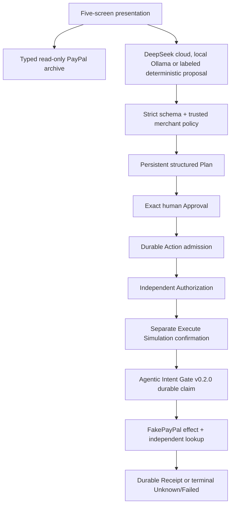

# Architecture and safety boundary

The judge-facing presentation and advanced operations app are separate entrypoints.
They share the installed public Runtime API, not financial state.

## Ownership and identity

The pinned external Runtime owns validation, persistent Runs, exact Plan binding,
compilation, capability verification, Authorization, claiming, CAS, effect identity
and terminal recovery. The consumer imports only `agentic_intent_gate.runtime` and
registers one reviewed SIDE_EFFECT tool. It does not copy or monkeypatch core code.

The consumer owns recommendation parsing, deterministic policy, provider clients,
receipt observations and UI. `IncidentPlanProvider` constructs the Plan from the
validated recommendation and trusted constants. The model cannot choose credentials,
code, target, binding, scope, budget or grant decisions. Tool identity is
`paypal_partial_refund@1`, target `paypal-sandbox-refunds`, adapter `paypal-sandbox-adapter`.

`application.sqlite3` stores incidents/observations; `gate.sqlite3` belongs to the
Runtime; `fake-paypal.sqlite3` is explicitly simulated. Observations are not an
execution-control store. Success requires the Runtime's exact receipt reference
and matching payload binding, not just an observation written locally.

## Presentation isolation

The presentation ignores `.env`, forces FakePayPal, binds loopback and serves fixed
assets plus closed-schema `/presentation/` projections/commands. Real
`/api/incidents/` routes and operations assets are absent. Historical proof is
hash-pinned and schema checked before serving.

Each case has fresh synthetic state under `.state-presentation-demo/`. Browser
input cannot select a private directory, Capture, merchant, credentials or profile.
Reset retains records and never copies grants. Restart uses the OS owner-fence
probe and public Runtime lock; competing owners fail closed. Windows resume is
qualified; cross-platform owner behavior is not.

The preferred live provider uses only `https://api.deepseek.com/chat/completions`,
requested model `deepseek-flash`, `stream: false`, `thinking: {type: disabled}`,
JSON Output and 512 output tokens. A 30-second total inference deadline and 64 KiB
response limit bound each attempt; the browser allows 35 seconds. Redirects,
environment proxies and automatic retries are disabled. Explicit process environment
credentials are used only in the fixed HTTPS Authorization header, never in Settings,
financial executors, browser responses or evidence. No `.env` is read.
The dedicated key has precedence over the generic key, including an empty dedicated
value causing a clear configuration error. Cloud input is restricted to the existing
server-owned synthetic cases A–D and three synthetic payment facts. Case E explicitly
uses a deterministic fixture. JSON validity never replaces six-field schema validation
or deterministic merchant policy. Requested/returned model IDs, duration, finish,
refusal and truncation metadata are explanatory evidence, never grants.

Local proposals use a fixed loopback endpoint/model, bounded output and a 45-second
total planning limit. Invalid/unavailable output preserves safe state. Only an
explicit fallback creates a deterministic case. Planning limits never increase
the five-second simulation execution budget.

## Sandbox policy and request path

The separate operations app reads the allowlisted Capture and associated Order,
validating merchant, status, exact Decimal money/currency and association. Policy
permits positive two-decimal USD/NZD partial refunds below captured total and the
configured maximum, with no reported prior refund. High uncertainty, REVIEW or
REJECT creates no executable Plan. Missing reported history is not an authoritative
complete refund-balance ledger.

Each Capture permits one product incident per state directory, including rejected
or interrupted cases. A new directory must never bypass an unresolved real effect.
Facts are freshly revalidated before POST. Outbound URLs are fixed and locally
constructed; HATEOAS links are never followed. Only `api-m.sandbox.paypal.com` and
`api.sandbox.paypal.com` are accepted as strictly verified metadata, with correct
HTTPS/port/path/ID/relation/method and no credential-bearing or malformed URL.

The executor preserves durable effect identity, synchronous dispatch fencing,
deadline/cancellation rechecks and `PayPal-Request-Id`. Capture/Order reads can
use the trusted saved association concurrently, sharing OAuth cache and client.
No facts validation is dropped to reduce latency. Independent Refund GET and
adapter-side durable receipt persistence are required before confirmed success.

## Budgets and outcomes

| Property                   | Default / presentation          | Reviewed historical Sandbox profile |
| -------------------------- | ------------------------------- | ----------------------------------- |
| Adapter budget             | 5 seconds                       | 15 seconds                          |
| Binding revision           | `refund-binding-v1`             | `refund-binding-v2.exec-15s`        |
| HTTP read ceiling          | 2 seconds                       | 4 seconds                           |
| Connect/write/pool ceiling | 1.1 seconds                     | 1.1 seconds                         |
| Extra pre-dispatch reserve | Existing deadline/cancel checks | 9 seconds remaining                 |

Trusted host code alone selects the profile. Extended identity uses public
`execution_budget_binding`, a fresh base revision/scope and separate private
gate/receipt-store identity. Old Plans, Approvals, Actions or grants cannot be
elevated. The direct public Gateway supports the full extended profile; bundled
Runtime HTTP routes retain a ten-second parent deadline. The general developer
CLI defaults to five seconds and has no profile-selection flag.

The adapter timer starts after claim; synchronous claim/finish are outside it.
Caller deadlines only shorten it. Rechecks after persistence and immediately before
POST prevent new dispatch after observed expiry/cancellation. Blocking Python and
already-dispatched remote effects cannot necessarily be preempted.

| Evidence                                                                                     | Result                                              |
| -------------------------------------------------------------------------------------------- | --------------------------------------------------- |
| Refund GET verifies COMPLETED, exact IDs/capture/money and durable receipt binding           | Succeeded                                           |
| Proven pre-dispatch no-effect rejection or supported definitive provider rejection           | Failed                                              |
| Lost acknowledgment, ambiguous transport/verification, late outcome or uncertain persistence | Unknown; preserve evidence and stop                 |
| Provider PENDING/FAILED/CANCELLED without supported no-effect proof                          | Unknown; provider status remains separately visible |

Unknown is terminal. No blind retry, new Action to replay an effect, automatic
reconciliation or background financial execution is provided. A request ID does
not establish universal exactly-once delivery. Manual verification uses GET and
appends observations; it neither rewrites Unknown nor dispatches POST.

## Practical limits

One process owns each Runtime state. Protected operations require the private Bearer
capability. Host/origin checks, CSP and no-store headers are local protections,
not production multi-user authentication or malicious-Python isolation. Cross-store
writes are not atomic; interrupted incidents remain reserved. External PayPal
activity and provider retention limits remain outside local guarantees.

See the unchanged [backend freeze](PHASE2-BACKEND-FREEZE.md),
[Sandbox developer guide](sandbox-setup.md) and
[immutable historical proof](../evidence/phase2-freeze/verified-refund.json).
